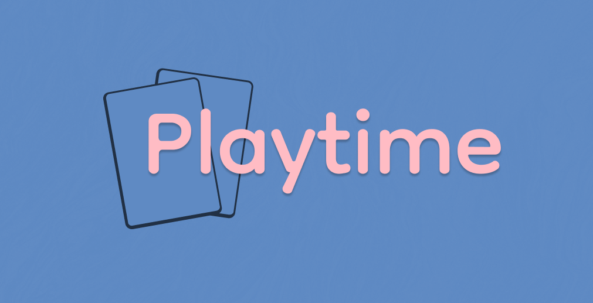

🃏 Playtime.nvim
==

A collection of (mostly card) games for Neovim that I (mostly) like.

> Playtime is a bit of a toy and currently does not have semver releases.
> Configuration options, stats and included games may change or disappear.
> Some interface or interactions may be wonky.


Requirements
--

- Neovim `0.9+`?
- A pointing device (*keyboard only navigation not currently supported!*)

Included games
--

Some of the included games have (much nicer) for-sale digital or physical
versions. **If you like the game, buy it!**

**Classic Solitaires**

[FreeCell](fnl/playtime/game/freecell/README.md) & [Bakers
Game](fnl/playtime/game/freecell/README.md#variants).
[Spider](fnl/playtime/game/spider/README.md) (4, 2 and 1 suit variants).

**Classic-style Solitaires**

[Shenzhen Solitaire](fnl/playtime/game/shenzhen-solitaire/README.md).
[Penguin](fnl/playtime/game/penguin/README.md).
[Curds & Whey](fnl/playtime/game/curds-and-whey/README.md).
[Forty Fortunes](fnl/playtime/game/forty-fortunes/README.md).

**Solo card games**

[The Emissary](fnl/playtime/game/the-emissary/README.md) (trick-taking).

**Other games**

[SET](fnl/playtime/game/set/README.md) (logic puzzle).
[Sweeper](fnl/playtime/game/sweeper/README.md).

**Instructions**

Basic how-to-play guides are included in the links above or via the "How
to play" menu item, with additional links to more complete or thematic
instructions. Accessing some external instructions may require a Board Game
Geek account (free), check the "files" section after logging in.

Installation
--

Point your favorite Neovim plugin installer at `github.com/rktjmp/playtime.nvim`.

Usage
--

Execute `:Playtime <game> <?seed>` to run a game (use tab completion for a game
list) or simply `:Playtime` for a graphical menu (scroll down for more games).

Most games support dragging cards to the appropriate positions, and clicking to
"pick up" card(s) then clicking elsewhere to "put down" the card(s). Right
clicking releases cards.

Invalid moves are reported using `vim.notify` so they appear in the command bar
by default or via any custom notifier you may have installed.

**Playtime minimises itself when the window loses focus. Refocusing the window
re-raises the game.**

Configuration
--

Playtime may be configured by calling `require("playtime").setup({})`.

**You do not need to call setup unless you are altering a default option.**

Supported options (struck through options are currently ... not supported):

> Note: you may specify options in Lua style (`window_position`) or Fennel style (`window-position`).

- `fps` (`30`): Animation frames-per-second. Must be greater than 1.
- `window-border` (`nil`): Floating window border style. If not set here,
  windows will use Neovims `vim.opt.winborder` value or `"shadow"` if that
  option is not set.
- `window-position` (`center`): Where to position the game window, may be
  `center`, `ne`, `nw` or a table or function that returns `{row=row, col=col}`.
- `minimise-position` (`se`): Where to position the minimised window, may be
  `ne`, `nw`, `se`, `sw` or a table or function that returns `{row=row, col=col}`.
- `__beta-game-set-font-glyph-width` (`nil`): Hint to playtime that the font
  glyphs used by SET are wider than one character, may be `wide` or `nil`. If
  your cards look off center, try setting this to `wide`. *Note: this option
  will change name at some point...*
- ~~`unfocused` (`minimise`): what to do when the window loses focus.~~

You may also adjust the colors, see the [FAQ](#FAQ).

Building
--

Playtime is written in [Fennel](https://fennel-lang.org), and uses
[hotpot.nvim](https://github.com/rktjmp/hotpot.nvim) as its build system.

To make changes, install hotpot.nvim and reload neovim, then when saving any
`.fnl` file, they will automatically be compiled to lua.

If submitting a patch, it's preferable to include just the changes to `fnl/`
for review.

FAQ
--

> **I thought this was a Neovim plugin, why do I need a mouse?!**

When I wrote
[shenzhen-solitaire.nvim](https://github.com/rktjmp/shenzhen-solitaire.nvim), I
included support for keyboard control, then never used it once in two years.

Initially I did include keyboard controls in Playtime but again - never used
them. I am not *against* including keyboard controls, especially in regard
accessibility, but the simplest "tab around positions" is painfully
slow to use and building a [leap](https://github.com/ggandor/leap.nvim)-like
interface was a bit more than I wanted to take on initially.

Some terminals or setups might struggle with a mouse-only interface, such as
ssh+terminal.app. If you are having trouble, first confirm that your terminal
supports both left and right click (may require an modifier key) and that the
events are being sent over ssh *or whatever*. You might also have to enable the
mouse in Neovim or something. Think of it as a fun puzzle to solve! Wow, a free
extra game!

> **My colors are U. G. L. Y.**

Playtime currently uses a limited "traditional" color palette of red, green,
yellow, orange, blue, magenta, cyan, white and black.

Where possible, colors are derived from existing highlight groups. No
background color or text effects are kept, for this reason, the groups are
*not* linked. Some colors names may not match their visual appearance, for
example `PlaytimeGreen` may be blue if your color scheme defines `DiagnosticOk`
to be blue.

Yellow, magenta and cyan are defined by Playtime itself because existing
highlight groups did not provide a reliable default choice.

You can override the colors by defining any of the following highlight groups:

```lua
PlaytimeNormal     -- NormalFloat.fg, "general" elements
PlaytimeMuted      -- Comment.fg, disabled or "dim" elements
PlaytimeBackground -- NormalFloat, window background
PlaytimeMenu       -- PmenuSBar, "top menu" bar color
PlaytimeWhite      -- NormalFloat.fg
PlaytimeBlack      -- Comment.fg
PlaytimeRed        -- DiagnosticError.fg
PlaytimeGreen      -- DiagnosticOk.fg
PlaytimeYellow     -- Defined manually
PlaytimeOrange     -- DiagnosticWarn.fg
PlaytimeBlue       -- DiagnosticInfo.fg
PlaytimeMagenta    -- Defined manually
PlaytimeCyan       -- Defined manually
```

There are additional `@playtime.*` groups which link to the default groups
which you may define for per-game alterations or tweak additional UI elements.

> **My text is U. G. L. Y.**

I use the font [Iosevka](https://typeof.net/Iosevka/), so symbols are dictated
by its unicode coverage. Some fonts may not support some symbols, or may render
them in a different manner (2-ch wide instead of 1-ch for example). You may be
able to configure a fallback font for your terminal, the Noto family may be a
good option.

> **Why are my diamonds ✨gold✨ sometimes?**

I found differentiating the suit by their icons alone to be difficult
sometimes, so in games where *suits matter*, each suit is given their own
color.

You can alter this behaviour by linking
`@playtime.game.card.diamonds.four_colors` to `@playtime.game.card.diamonds`
and `@playtime.game.card.clubs.four_colors` to `@playtime.game.clubs.spades`.

> **I cant win <seed>!**

Playtime does not stack any decks to guarantee deals are winnable. Try holding
the appropriate totems or invoking an incantation to improve your luck stat next
time. Don't give up, skeleton!


